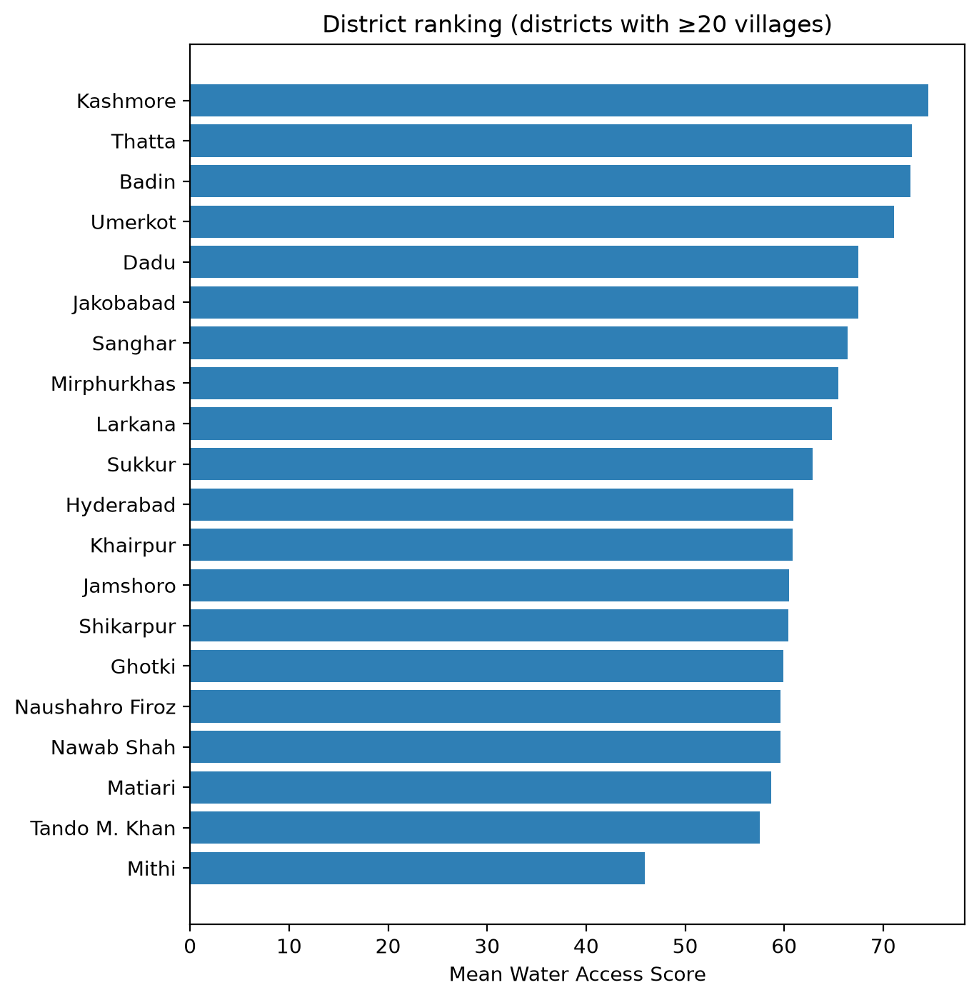
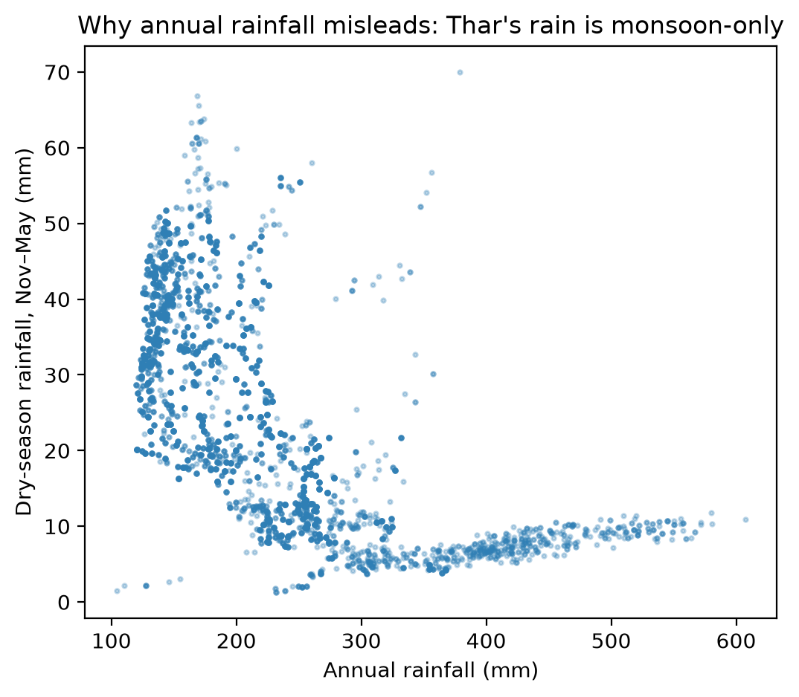

# Sindh Water Access Index (SWAI)

**Village-level drinking-water accessibility for 5,159 villages across Sindh, Pakistan — estimated entirely from open satellite and geospatial data.**



---

## Overview

Monitoring progress toward **SDG 6.1** (universal and equitable access to safe and affordable drinking water) in Pakistan relies on household surveys that are expensive, infrequent, and cannot resolve below the district level. This project asks whether openly available satellite and geospatial data can produce a useful **village-level** picture instead.

SWAI combines five open indicators into a relative 0–100 accessibility score for every village in Sindh. No field visits, no proprietary data, no paid APIs. The complete pipeline — from raw downloads to final dataset — is in this repository.

**The headline result is not the index itself. It is a methodological failure and its correction:** the standard approach to building such an index *inverts the ranking*, scoring Pakistan's driest district as its best-served. This repository documents why that happens, how to fix it, and what remains broken even after the fix.

---

## The dataset

`swai_final.csv` — one row per village (n = 5,159), containing coordinates, all five raw indicators, their normalized forms, the final score, and a band.

| Field | Description |
|---|---|
| `village_id` | Unique identifier (1–5,159) |
| `X`, `Y` | Longitude, latitude (EPSG:4326) |
| `name` | Village name from OpenStreetMap (68 unnamed) |
| `river_distance_km` | Distance to nearest perennial river or canal |
| `pop_sum` | Population within a 2 km radius |
| `rainfall_mm` | Mean annual precipitation |
| `dry_rain_mm` | Mean Nov–May precipitation |
| `NDWI`, `NDVI` | Surface-water and vegetation indices |
| `elevation_m` | Elevation above sea level |
| `R`, `P`, `W`, `N`, `E` | Normalized indicators (0–100) |
| `water_access_score` | Final composite score (0–100) |
| `band` | Poor / Moderate / Good (relative percentile bands) |

`swai_with_district.csv` adds a district column via spatial join against GADM level 3.

---

## Method

### Indicators

| Symbol | Indicator | Source | Native resolution | Direction |
|---|---|---|---|---|
| **R** | Distance to perennial water | HydroRIVERS v1.0 (filtered `DIS_AV_CMS > 1`) merged with OpenStreetMap `waterway=canal` | vector | Closer = better |
| **P** | Population within 2 km | WorldPop 2024, constrained, UN-adjusted | 100 m | Fewer = better |
| **W** | Dry-season rainfall (Nov–May) | CHIRPS daily, 2020–2024 | ~5.5 km | More = better |
| **N** | Surface water (NDWI) | Sentinel-2 SR Harmonized, 2023 cloud-masked median composite, 1 km buffer mean | 10–20 m | More = better |
| **E** | Elevation | SRTM 1 Arc-Second (`USGS/SRTMGL1_003`) | 30 m | Lower = better |

### Normalization

Raw indicators are on incompatible scales and are heavily skewed. Three steps precede scoring:

1. **Log transform** (`log1p`) on population and distance — both are multiplicatively skewed; the difference between 1 km and 10 km matters roughly as much as 10 km to 100 km.
2. **Winsorize** at the 1st/99th percentiles — a single village with 455,295 people within 2 km (Karachi's fringe) or 2 people (an isolated hamlet) would otherwise dictate where all others land.
3. **Min–max** rescale to 0–100, inverting where lower raw values mean better access.

Without steps 1–2 the index is degenerate. Naive min–max produced a population indicator with a **median of 98.5 and an interquartile range of 1.3** — every village collapsed into the top of the scale, distinguishing only "Karachi" from "not Karachi."

After correction, all five indicators discriminate:

| Indicator | IQR (higher = more discriminating) |
|---|---|
| R | 23.7 |
| P | 18.8 |
| W | 49.8 |
| N | 31.4 |
| E | 25.0 |

### Scoring

Rainfall and canal access are **substitutes, not complements**. A weighted sum assumes more of each is independently better; in reality, if a canal runs past your village, rainfall matters less, and if you are in the Thar desert with no canal, rainfall is everything. They are therefore aggregated non-compensatorily:

```
S = max(R, W)

Score = 0.45·S + 0.20·P + 0.20·N + 0.15·E
```

Bands are assigned by percentile (bottom 20% / middle 60% / top 20%), not by absolute thresholds. **Scores are relative within Sindh** — a score of 70 means "better served than most Sindhi villages," not "adequate by any external standard."

---

## Key finding: annual rainfall inverts the ranking



The standard approach — used in most published water-index work — treats **annual** rainfall as a water-supply indicator. In Sindh this produces a ranking that is not merely noisy but **backwards**.

Sindh has two distinct rainfall regimes:

- The **monsoon-dominated southeast and coast** receive up to 600 mm annually, but only ~10 mm falls between November and May. The rain arrives in roughly fifteen days of July–August, runs off or evaporates, and by March the ponds are dry.
- **Western and upper Sindh** receive as little as 120–170 mm annually, but 30–65 mm of it is spread across the dry months, delivered by winter westerly disturbances.

Annual rainfall is therefore **inversely related** to dry-season water availability across the province. Dry-season rain averages just **14.5% of the annual total** (range 0.6–39.6%).

### Consequences

| | Annual rainfall (naive) | Dry-season rainfall (corrected) |
|---|---|---|
| **Mithi** (Tharparkar — Pakistan's driest district) | 71.5 — **rank 1 of 25 (best)** | 45.9 — **rank 25 of 25 (worst)** |
| **Sukkur** (head of the Indus canal command) | 60.1 — rank 25 (worst) | 62.9 — rank 14 |
| R ↔ W correlation | **−0.62** (indicators cancel) | **+0.34** |
| R's contribution to score | 0.07 (inert) | 0.77 (dominant) |

The naive index also scored **Kharo Chhan (کھارو چھان)** at 85.8/100 — a town in the Indus delta substantially abandoned because seawater intrusion made its water undrinkable.

Substituting dry-season rainfall moves Tharparkar from best-served to worst-served, matching known drought conditions. This is the single most consequential decision in the pipeline.

---

## Robustness

District rankings are stable across weighting choices. Spearman rank correlation against the baseline weighting:

| Variant | ρ |
|---|---|
| Supply-heavy (S=0.60) | 0.958 |
| Supply-light (S=0.30) | 0.954 |
| No elevation (E=0.00) | 0.906 |
| Equal weights (0.25 each) | 0.907 |
| **Population direction reversed** | **0.835** |

Mithi ranks worst in five of six variants (21st of 25 in the sixth). **The headline finding does not depend on the weights.**

---

## Known limitations

These are stated prominently because they matter more than the score.

### 1. This measures accessibility, not potability

The index has no groundwater salinity data. **Thatta (72.9) and Badin (72.8) rank 2nd and 3rd best** — these are precisely the districts where seawater intrusion has rendered water undrinkable and driven abandonment. The model sees "surrounded by water, coastal rainfall" and scores it well.

This is a **structural blind spot, stable across every weighting variant** — not a tuning artifact. It cannot be fixed with the data used here. SDG 6.1 concerns *safely managed* water; this index addresses only the accessibility half.

### 2. The population indicator is inert

P correlates 0.06 with the final score despite a nominal 20% weight. Reversing its direction entirely — asserting the exact opposite of what the model claims — changes district rankings by only ρ = 0.84. Its apparent weight overstates its influence.

The underlying assumption ("more people = worse access") is also unexamined. Larger settlements often have *better* water infrastructure — piped supply, more handpumps, tanker routes. This direction was inherited uncritically and may simply be wrong.

### 3. No ground-truth validation

Every conclusion rests on the model agreeing with domain expectation. That is a plausibility check, not evidence. **This is the single largest gap.**

### 4. Data-specific caveats

- **HydroRIVERS discharge is naturalized** — it models natural flow *before* abstraction. The Indus below Kotri often runs at a fraction of its natural discharge. `DIS_AV_CMS` describes what *would* flow, not what does.
- **OSM village coverage is incomplete.** Places tagged `hamlet` were excluded; some villages are missing or mislabelled.
- **The NDWI composite is annual**, averaging monsoon and dry season and smoothing out seasonal water bodies. A dry-season composite would better represent April conditions.
- **The elevation indicator is weakly justified.** "Lower = better" (nearer water table) is arguable in Sindh, where low-lying also means flood-prone and salinity-affected. It contributes least (ρ = 0.38).
- **Rainfall is ~5.5 km resolution**, coarse relative to village spacing.
- One OSM feature had null geometry and was dropped (5,160 → 5,159).

---

## Notable results

**88.6% of Sindh's villages have a canal, not a natural river, as their nearest perennial water source** (4,573 canals vs 586 rivers). Any index for Sindh that uses only natural hydrography is measuring the wrong thing for nine villages in ten.

Filtering HydroRIVERS by discharge was equally consequential. Unfiltered, the median village's "nearest river" carried **0.026 m³/s — 26 litres per second**, an ephemeral desert wash. The index was measuring distance-to-ditch. Restricting to `> 1 m³/s` retained 770 of 6,358 segments.

---

## Reproducing

### Prerequisites

- Python 3.11+
- QGIS (Long Term Release)
- A Google Earth Engine account with a registered Cloud project (Community tier — free)

### Data downloads (excluded from this repo)

Large rasters are not committed. Download:

| Data | Source |
|---|---|
| Administrative boundaries | [gadm.org](https://gadm.org/download_country.html) — Pakistan, shapefile |
| Villages & canals | [download.geofabrik.de](https://download.geofabrik.de/asia/pakistan.html) — `pakistan-latest-free.shp.zip` |
| Population | [hub.worldpop.org](https://hub.worldpop.org/) — Pakistan 2024, 100 m constrained UN-adjusted |
| Rivers | [hydrosheds.org](https://www.hydrosheds.org/products/hydrorivers) — HydroRIVERS Asia |

Rainfall, NDWI and elevation are computed in Earth Engine — no manual download needed.

### Pipeline

```bash
pip install -r requirements.txt
```

**1. GIS preparation (QGIS)**

- Filter GADM level 1 to `"NAME_1" = 'Sindh'` → `sindh_boundary.gpkg`
- Filter OSM places to `"fclass" = 'village'`, clip to Sindh, add sequential `village_id` → `sindh_villages.gpkg`
- Clip WorldPop to Sindh, reproject to **EPSG:32642 (UTM 42N)** → `population_utm.tif`
- Filter HydroRIVERS to `"DIS_AV_CMS" > 1`, reproject → `rivers_perennial.gpkg`
- Filter OSM waterways to `"fclass" = 'canal'`, clip, reproject → `canals_utm.gpkg`
- Merge rivers + canals → `water_lines_utm.gpkg`
- `Join attributes by nearest` (villages → water lines) → export `village_water_distance.csv`
- Buffer villages by 2000 m → `villages_buffer2km.gpkg`

> **Reproject to a metric CRS before measuring any distance.** In EPSG:4326 distances come out in degrees and are meaningless.

**2. Earth Engine**

Upload `sindh_villages` as an asset (zip the shapefile *files*, not the folder), update the asset path in each script, then run:

```
gee/gee01_rainfall_elevation.js   → village_rainfall_v2.csv, village_elevation_v2.csv
gee/gee02_ndwi_ndvi.js            → village_ndwi.csv
gee/gee03_dryseason_rainfall.js   → village_dryrain.csv
```

Download the exports from Google Drive into the project root.

**3. Analysis**

```bash
python zonal_pop.py            # population within 2 km  → village_population.csv
python build_indicators.py     # merge all indicators    → indicators_raw.csv
python normalize_indicators.py # log + winsorize + scale → indicators_normalized.csv
python compute_score.py        # weighted score + bands  → swai_final.csv
python district_summary.py     # spatial join, ranking   → swai_with_district.csv
python sensitivity.py          # weight robustness
python figures.py              # figures 1–3
python make_map.py             # interactive map         → swai_map.html
```

---

## Repository contents

```
gee/                          Earth Engine scripts (JavaScript)
zonal_pop.py                  Zonal statistics for population
build_indicators.py           Merge, dedupe, unit conversion
normalize_indicators.py       Log transform, winsorize, min-max
compute_score.py              Composite score and bands
district_summary.py           Spatial join to GADM districts
sensitivity.py                Weight-robustness analysis
figures.py                    Publication figures
make_map.py                   Interactive Folium map

swai_final.csv                ★ The dataset
swai_with_district.csv        Dataset with district labels
indicators_raw.csv            Raw merged indicators
indicators_normalized.csv     Normalized indicators
district_summary.csv          District-level aggregates
swai_map.html                 Interactive map (open in a browser)
fig1_distribution.png         Score distribution
fig2_districts.png            District ranking
fig3_seasonality.png          Annual vs dry-season rainfall
```

---

## Future work

Ordered by value, not ease:

1. **Ground-truth validation.** Visit 40–60 villages spanning the predicted range; record actual source type, walk time, salinity, seasonal reliability. Correlate against predicted scores. This converts the index from hypothesis to instrument.
2. **Validate against published water-quality studies.** Existing Water Quality Index literature covers Thatta, Sujawal and Larkana with field-sampled groundwater. Those districts are exactly where this model fails — their published results offer a quantified check without new fieldwork.
3. **Add a salinity dimension.** In the delta and Thar, salinity *is* water access. This is the most Sindh-specific improvement available and would address the model's central flaw.
4. **Dry-season NDWI.** Does surface water still exist in April? That is the question that matters.
5. **The 2022 floods as a natural experiment.** Compute the index for 2021 and 2023 — did access improve or collapse?

---

## Data sources & licensing

| Source | License |
|---|---|
| WorldPop | CC BY 4.0 |
| HydroSHEDS / HydroRIVERS | Free for non-commercial use |
| OpenStreetMap (via Geofabrik) | ODbL |
| CHIRPS (UCSB Climate Hazards Group) | Public domain |
| Copernicus Sentinel-2 | Free and open |
| NASA/USGS SRTM | Public domain |
| GADM | Non-commercial use only |

**This project is for non-commercial research and educational use.** Code is released under the MIT License; derived data inherits the constraints of its sources.

---

## Citation

```bibtex
@misc{kaleem2026swai,
  author = {Kaleem, Arsalan},
  title  = {Sindh Water Access Index: Village-Level Drinking-Water
            Accessibility from Open Geospatial Data},
  year   = {2026},
  url    = {https://github.com/ArsalanKaleem/Sindh-Water-Access-index-SWAI-}
}
```

---

## Author

**Arsalan Kaleem**

- Portfolio — [arsalankaleem.github.io/portfolio](https://arsalankaleem.github.io/portfolio/)
- LinkedIn — [linkedin.com/in/arsalankaleem](https://www.linkedin.com/in/arsalankaleem)
- GitHub — [@ArsalanKaleem](https://github.com/ArsalanKaleem)
- Email — arsalanabbasi.here@gmail.com

Feedback, corrections and collaboration are welcome — particularly from anyone with field data on water access or groundwater salinity in Sindh.
